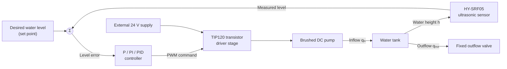
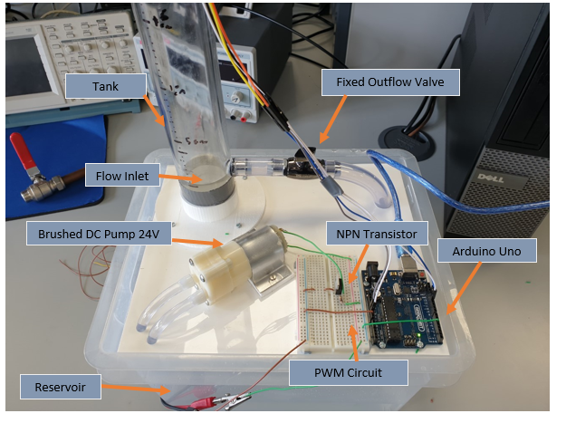
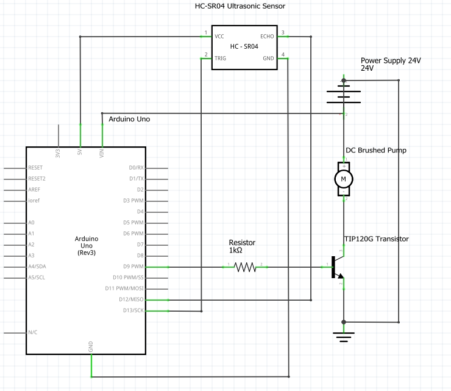
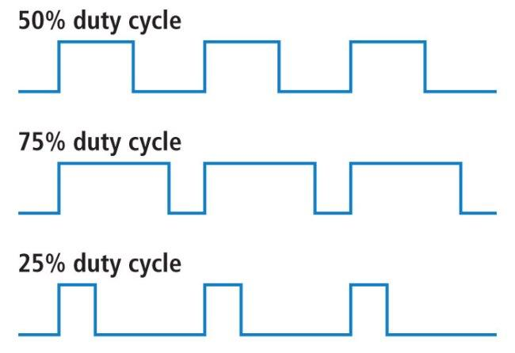

# Automated-resevoir-System
Built an Arduino-based closed-loop water-level controller using ultrasonic sensing and PWM pump control; modelled and tuned PID behaviour in MATLAB/Simulink, considering sensor placement and flow disturbances. 

# Closed-Loop Water Tank Level Control

> **Engineering project documentation**  
> EE199 Final Report · Department of Electronic Engineering · National University of Ireland Maynooth  
> Project group: Alex Harpur, Caolán O’Corrigan, Calum Brown, Victor Andrushkiv, Emmanuel Soriano, Daniel Sirbu, and Clinton Nkpa  
> Project facilitator: Seán Doherty

## Project overview

This project designed, modelled, implemented, and tested a closed-loop water-tank level-control system. An Arduino Uno measured the water level using an HY-SRF05 ultrasonic sensor and controlled a brushed 24 V DC pump through PWM and a TIP120 NPN Darlington transistor. MATLAB/Simulink provided the control-system interface and modelling environment.

The investigation covered proportional (P), proportional–integral (PI), and proportional–integral–derivative (PID) control. The physical system was intended for use in an undergraduate laboratory environment.

### Objectives

- Develop a physical system capable of regulating water height in a tank.
- Investigate feedback control, particularly P and PID control.
- Derive a mathematical model for the tank dynamics.
- Implement and test a control model in MATLAB/Simulink.
- Compare the practical response under different controller configurations.

## System architecture

The system forms a feedback loop: the sensor measures the water level, the controller compares it with the set point, and the pump changes the inflow to reduce the resulting error.

### Main hardware

| Component | Function / implementation |
|---|---|
| Arduino Uno | Processing and control interface |
| HY-SRF05 ultrasonic sensor | Non-contact measurement of water level |
| Brushed 24 V DC pump | Moves water from the reservoir into the tank |
| TIP120 transistor | Switches the pump using the Arduino PWM command |
| External 24 V supply | Supplies pump power |
| Recycled Perspex tank | Main controlled vessel |
| Recycled storage box | Water reservoir |
| Adjustable/fixed outflow valve | Establishes the tank outflow |
| Breadboard, fittings, and tubing | Circuit and hydraulic connections |
| 3D-printed parts | Sensor housing and tank mounting bracket |

The pump was driven from an external supply because the Arduino could not provide the required pump power directly. The Arduino PWM output was connected to the TIP120 base through the driver circuit. The report identifies Arduino PWM pin 5 as the pump-control output.

## Physical implementation

The physical layout prioritized functionality, visibility of components, available equipment, and build time. The water inlet was placed at the base of the tank to reduce interference with ultrasonic measurements caused by incoming water. A 3D-printed housing was made for the sensor, and a 3D-printed bracket was used to mount the tank.

*Physical prototype. The original report labels the tank, flow inlet, fixed outflow valve, brushed DC pump, NPN transistor, Arduino Uno, PWM circuit, and reservoir.*

### Circuit

*Circuit arrangement reproduced from the project report. Refer to the original component datasheets and circuit drawing before rebuilding; this image is documentation, not a wiring safety approval.*

## Control theory

### Pulse-width modulation

Pulse-width modulation (PWM) controls the average power delivered to a load by switching a digital output between its high and low states. The duty cycle is the proportion of each period for which the signal is high:

\[
D = \frac{t_{\mathrm{on}}}{T}\times 100\%
\]

For an ideal switching signal between 0 V and \(V_H\), its average voltage is:

\[
V_{\mathrm{avg}} = \frac{D}{100}V_H
\]

For example, a 50% duty cycle with a 5 V logic signal has an ideal average voltage of 2.5 V. This is an average representation; PWM is still a switched digital waveform, not a true analogue output.

### Feedback and proportional control

The controller uses the difference between the desired level and the measured level:

\[
e(t)=r(t)-h(t)
\]

where:

- \(r(t)\) is the desired water level (set point);
- \(h(t)\) is the measured water level;
- \(e(t)\) is the instantaneous level error.

A proportional controller produces an output proportional to this error:

\[
u(t)=u_0+K_p e(t)
\]

where \(K_p\) is proportional gain and \(u_0\) is the controller output at zero error. In this implementation, the controller output is ultimately used to determine the pump PWM command.

A larger proportional gain increases the response to a given error. Excessive gain can cause overshoot or instability, while sensor noise and finite measurement resolution can limit useful gain.

### PI and PID control

A PID controller combines proportional, integral, and derivative actions:

\[
u(t)=K_p e(t)+K_i\int_0^t e(\tau)\,d\tau
+K_d\frac{de(t)}{dt}
\]

The terms serve different purposes:

- **Proportional:** responds to the present error.
- **Integral:** accumulates error over time and can remove steady-state offset.
- **Derivative:** responds to the rate of change of error and can improve the transient response.

The corresponding ideal continuous-time controller transfer function is:

\[
C(s)=K_p+\frac{K_i}{s}+K_d s
\]

The project investigated P, PI, and PID configurations experimentally. The report notes that the Ziegler–Nichols tuning rules were not applied because the system was already a stable closed-loop system; controller gains were adjusted manually.

### Ziegler–Nichols tuning background

The report reviews two classical Ziegler–Nichols approaches:

1. **Open-loop reaction-curve method:** characterize a step response using an apparent delay \(L\) and time constant \(T\), then use the reaction-curve tuning table.
2. **Closed-loop stability-limit method:** set integral and derivative action to zero, increase proportional gain until sustained oscillation occurs, and use the ultimate gain \(K_{cr}\) and oscillation period \(P_{cr}\) to select controller parameters.

These methods are included as background research. They were not the tuning procedure used for the final physical system.

## Mathematical model of the tank

### Variables and assumptions

The report models a single tank with inflow \(q_{\mathrm{in}}\), outflow \(q_{\mathrm{out}}\), water height \(h\), and tank cross-sectional area \(A\).

For a constant cross-sectional area:

\[
V(t)=A h(t)
\]

Conservation of volume gives:

\[
\frac{dV(t)}{dt}=q_{\mathrm{in}}(t)-q_{\mathrm{out}}(t)
\]

Since \(A\) is constant:

\[
A\frac{dh(t)}{dt}=q_{\mathrm{in}}(t)-q_{\mathrm{out}}(t)
\]

The report uses a linear outflow approximation in which outflow is proportional to water height:

\[
q_{\mathrm{out}}(t)=k h(t)
\]

where \(k\) is a proportionality constant representing the hydraulic characteristics of the outlet and system. Substituting gives:

\[
A\frac{dh(t)}{dt}+k h(t)=q_{\mathrm{in}}(t)
\]

Taking the Laplace transform with zero initial conditions:

\[
(As+k)H(s)=Q_{\mathrm{in}}(s)
\]

Therefore, the first-order plant transfer function is:

\[
\boxed{G(s)=\frac{H(s)}{Q_{\mathrm{in}}(s)}
=\frac{1}{As+k}}
\]

This is the first-order model used in the report's theoretical Simulink representation. It is the report's linearized/assumed outflow model; it should not be interpreted as a universal model for every tank outlet geometry.

### Theoretical control-loop model

The theoretical plant's step response is shown below.

## MATLAB and Simulink implementation

The project used MATLAB/Simulink to model the control loop and interface with the Arduino-based physical system. The practical model included:

- A desired water-level reference.
- Arduino digital-read input for the ultrasonic measurement.
- Scaling of the measured sensor value.
- Error calculation.
- PID controller block.
- Output to the Arduino analogue-write/PWM interface.
- Scopes and workspace outputs for monitoring height, error, and motor command.

The source report describes a real-time pacing setting with a speed-up factor of 1 in the practical model.

## Ultrasonic measurement and embedded implementation

The HY-SRF05 sensor measures the distance from the sensor to the water surface. The report's Arduino code uses:

- Trigger pin: 13
- Echo pin: 12
- Sensor mounting height constant: 29 cm
- Dead-space correction: 5 cm

The ultrasonic pulse duration is converted to distance using the code's approximation:

\[
d_{\mathrm{cm}}=\frac{t_{\mu s}}{29.1\times 2}
\]

The reported water-height calculation is:

\[
h_{\mathrm{scaled}}=100(29-d_{\mathrm{cm}}-5)
\]

The multiplication by 100 is used in the code to transmit an integer-scaled value to Simulink; the accompanying comments state that Simulink divides by 100. The 5 cm correction accounts for the outlet valve being approximately 5 cm above the tank base.

> **Implementation note:** The constants above are taken from the submitted code (`SENSOR_HEIGHT = 29`, `DEAD_SPACE = 5`). They are specific to the physical prototype's sensor mounting and geometry and would need recalibration if the arrangement changed.

## Experimental procedure and results

### Test procedure

The target water height was set to **10 cm**. The P, I, and D parameters were then adjusted to obtain a suitable response. Manual tuning was selected because the Ziegler–Nichols methods considered in the background research were not applicable to the system's stable closed-loop behavior.

### Proportional-only response

The P-only configuration used the gains shown in the chart title: \(P=25,\ I=0,\ D=0\). The measured level rises quickly but remains below the 10 cm set point, leaving a steady-state error. The corresponding error plot shows the residual offset.

### Proportional–integral response

After integral action was introduced, the report states that the system reached the desired outcome without overshoot or steady-state error. It reports that the response settled at approximately **15 seconds**.

### PID response

After derivative action was added, the report states that the system reached steady state at approximately **12 seconds**, with no overshoot and no steady-state error.

### Results summary

| Controller | Reported behavior |
|---|---|
| P | Fast initial rise, but a persistent steady-state offset remained |
| PI | Reached the target without overshoot or steady-state error; settled at approximately 15 s |
| PID | Reached steady state at approximately 12 s, with no overshoot or steady-state error |

The times above are the values stated in the original report. They are not newly calculated from digitized chart data.

## Evaluation

The project report concluded that the system achieved the stated project aim and operated as a physical closed-loop water-level controller. It also identified opportunities for improvement, including a potentially more cylindrical tank design and a more efficient implementation as the team's engineering knowledge developed.

### Design considerations and sustainability

The report records the following considerations:

- Reuse of the Perspex tank, reservoir, Arduino, ultrasonic sensor, cables, and breadboard where available.
- Consideration of RoHS requirements when sourcing components.
- Consideration of WEEE and end-of-life reuse of individual components.
- Use of 3D printing to reduce material waste relative to subtractive manufacturing.
- Minimal soldering to improve component reuse.
- Modular construction to reduce replacement cost and material waste.
- Acknowledgement of technical and academic assistance received during the project.

## Conclusion

The project developed a working closed-loop water-tank level-control system using an Arduino Uno, ultrasonic level sensing, a PWM-controlled DC pump, and MATLAB/Simulink. The tank dynamics were represented using a first-order model, and P, PI, and PID control were investigated.

The reported tests showed that proportional-only control left a steady-state offset. Adding integral action removed the offset, with the response settling at approximately 15 seconds. Adding derivative action produced a reported settling time of approximately 12 seconds without overshoot or steady-state error.

The project brought together physical prototyping, embedded interfacing, mathematical modelling, feedback control, simulation, and experimental verification.

## Project acknowledgements

The original report acknowledges assistance from:

- John Maloco — component procurement, PWM circuitry, 3D-printing training, and lab support.
- Dennis Buckley — miscellaneous laboratory assistance.
- Seamus McLoone — technical confirmation and academic guidance.
- Seán Doherty — document review and feedback.
- Andrew Meehan — layout and referencing guidance.
- Connor Murphy — MATLAB/Simulink interfacing assistance.
- Daire O’Broin — MATLAB support, presentation preparation, and general advice.

## References

The following references are transcribed from the original project report. Some are historical links and may have changed since the report was written (2019).

1. AnalogicTips, “Pulse Width Modulation (PWM),” https://www.analogictips.com/pulse-width-modulation-pwm/
2. SparkFun, “Pulse Width Modulation,” https://learn.sparkfun.com/tutorials/pulse-width-modulation/all
3. Control Station, “What Is Proportional-Only Control? When Should P-Only Control Be Used?”, https://controlstation.com/what-is-proportional-only-control-when-should-p-only-control-be-used/
4. TechTarget, “Proportional Control,” https://whatis.techtarget.com/definition/proportional-control
5. “The Basics of Control System Design: Tuning a Proportional Controller,” Embedded.com, https://www.embedded.com/design/system-integration/4007564/The-basics-of-control-system-design-Part-2--Tuning-a-Proportional-Controller
6. A. G. Mutambara, *Design and Analysis of Control Systems*, CRC Press, 1999, pp. 294–298.
7. S. McLoone, *EE114 Notes*, Maynooth University, 2019.
8. B. R. Copeland, “Ziegler–Nichols tuning,” 2008, http://educypedia.karadimov.info/library/Ziegler_Nichols.pdf
9. SparkFun, “Motors and Selecting the Right One,” https://learn.sparkfun.com/tutorials/motors-and-selecting-the-right-one/all
10. onsemi, TIP120 datasheet, https://www.onsemi.com/pub/Collateral/TIP120-D.PDF
11. Arduino Project Hub, “Distance Measurement with an Ultrasonic Sensor HY-SRF05,” https://create.arduino.cc/projecthub/Nicholas_N/distance-measurement-with-an-ultrasonic-sensor-hy-srf05-64554e
12. Elektor, HY-SRF05 ultrasonic distance sensor, https://www.elektor.com/ultrasonic-distance-sensor-hy-srf05-160044-71
13. Jontas, ultrasonic sensor code reference, http://www.f15ijp.com/
14. Giampiero Campa, “Analog and Digital Input and Output Servers for MATLAB,” The MathWorks, Inc., 2013.

## Repository contents

- `README.md` — this project document.
- `Automated-resevoir-System/` — original project figures and experimental charts extracted from the submitted report.

